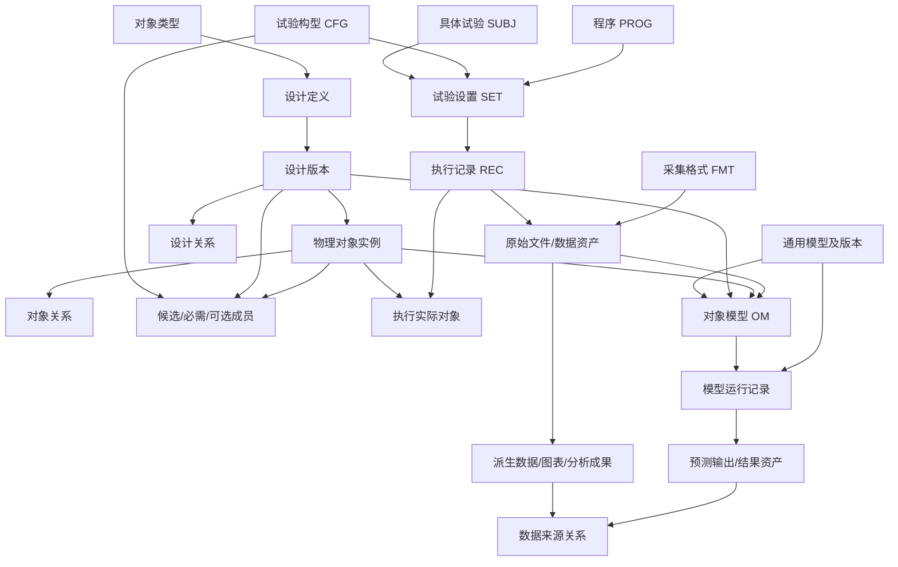

# 后端数据模型与数据流转（基础版）

## 目标与边界

本文定义 ProTangram 当前后端领域数据的第一版契约，供后端实现与后续前端适配使用。依据仓库现有前端、后端和《电涵道风扇试验数据结构.html》整理；它不是把 HTML 中每个概念机械地转换成数据库表，也不代表全部专业功能已经实现。

现有 `/api/experiments`、`/api/templates`、`/api/projects`、`/api/reports` 等旧接口及其 JSON 文件存储暂时保留。新增领域 API 使用独立 SQLite 文件 `data/protangram-domain.sqlite`，上传文件保存在 `data/domain-files/`。当前不自动迁移浏览器 localStorage、IndexedDB 或旧 JSON 数据。

## 核心数据与用途

| 数据 | 保存内容 | 主要使用位置 |
|---|---|---|
| 对象类型 | 类型名称、字段定义、允许关系的描述性配置 | 对象创建、参数表单、关联校验 |
| 设计定义 / 设计版本 | 方案身份、版本、设计参数、要求值 | 设计比较、模型适用性、历史追溯 |
| 物理对象 | 唯一对象编号、对象类型、对应设计版本、实物状态和元数据 | 物理对象浏览、试验选件、执行追溯 |
| 设计关系 / 对象关系 | 两端对象、关系类型、角色、有效时间及附加信息 | 组成结构、演变关系、安装和复用关系 |
| 试验构型 CFG | 构型身份及其成员 | 记录候选被试对象、供电对象、陪试件、设备 |
| 具体试验 SUBJ | 试验身份、目的、状态 | 组织试验设置和执行记录 |
| 程序 PROG / 试验设置 SET | 程序版本、构型引用、变量取值、要求 | 定义一次试验所采用的方案与工况 |
| 执行记录 REC | 实际条件、时间、状态、结论、实际参与对象 | 试验历史、数据归档、结果追溯 |
| 数据格式 FMT / 数据资产 | 列语义、单位、时间定义、无效判据、文件位置、校验值 | 原始数据导入、解析、数据集和图表来源 |
| 通用模型 MODEL / 版本 | 模型类型、方法位置、输入输出约束、适用范围、验证证据 | 模型注册和版本选择 |
| 对象模型 OM | 通用模型版本、适用对象、对象参数、训练/标定/验证数据角色 | 对象适配、模型适用性判断 |
| 模型运行 | 模型版本、目标对象、输入快照、输入资产、输出、状态和错误 | 预测结果展示、复算和审计 |
| 图表 / 分析成果 | 作为数据资产保存，并通过来源关系连接原始数据或运行结果 | 结果复用、报告引用、根因分析 |

参数和附加属性使用 JSON 保存，以便支持不同对象类型；对象身份、版本、关键外键和关系端点使用独立字段。JSON 不是替代所有关系表：需要检索、校验或复用的关系仍独立保存。

## 关系与数据流

数据流为：创建对象类型和设计定义 → 维护设计版本及物理对象 → 按实际需要建立对象关系 → 建立试验构型和具体试验 → 记录设置与执行 → 导入原始文件并关联采集格式 → 按需生成派生数据、图表或分析成果 → 注册通用模型及对象适配 → 保存模型运行输入、版本和输出。

原始文件应保持不变。解析、列映射、单位换算、过滤和时间对齐产生的新数据应作为派生资产，并通过来源关系指向输入资产。当前接口保存格式定义与资产元数据，但尚未实现完整 CSV 解析器、时间对齐或真实模型执行。

## 关键关系规则

- 设计定义与设计版本分开；物理对象可以引用一个设计版本，但设计方案不等同于实物实例。
- 设计组成关系与实际对象关系分开。导航树可以由关系查询生成，不是底层唯一的数据结构。
- CFG 成员支持 `subject_candidate`、`power_source`、`companion`、`equipment` 等角色，并区分候选、必需和可选；当前基础 API 不强制每个试验都必须使用 CFG。
- 一个执行记录属于一个具体试验，可以引用一组试验设置，也可以在探索阶段暂不指定设置；同一执行记录可关联多个实际试验件、被测部件和设备。
- 模型版本、对象模型和模型运行分开。训练、标定、验证数据以不同角色关联；模型运行保存输入快照和输入资产，后续结果可以登记为输出资产。
- 关联端点使用稳定 ID；引用中的对象、版本或资产不可被静默级联删除。历史运行的输入快照不会随对象或模型后续修改而改变。

## HTML 与当前前端的映射

| HTML 概念 | 当前后端基础模型 | 与当前前端的关系 |
|---|---|---|
| OBJ | `physical_objects`，并以 `designs/design_versions` 表达设计侧身份 | 前端 `PhysicalConfiguration` 混合承载对象与构型，不能直接照搬 |
| CFG | `trial_configurations` + `configuration_members` | 前端没有独立、可复用的对应实体 |
| SUBJ | `trials` | 对应当前 `ConcreteTrial` 的部分业务职责，需后续迁移/适配 |
| SET | `trial_settings` | 当前前端没有独立实体；不应继续把所有变量值塞入具体试验 |
| PROG | `programs` | 当前前端部分信息以自由文本载荷谱表达，不能自动推断为程序 ID |
| REC | `execution_records` + `execution_objects` | 对应当前 `TestRecord` 的部分职责 |
| FMT | `data_formats` | 当前前端主要保存文件名、表头和行数，语义映射尚不完整 |
| MODEL / OM | `models/model_versions`、`object_models` | 当前前端模型数据结构需要后续适配 |
| 图表与成果 | `data_assets` + `asset_links/asset_relations` | 旧前端成果仍由现有存储管理；尚未迁移到新资产库 |

## 当前实现范围

新增 `/api/domain` 接口提供核心实体的基础创建、列表/详情读取、关系维护、数据格式登记、文件上传与校验值计算、模型版本登记、对象模型关联及模型运行留痕。数据库使用仓库已有的 `sql.js` 依赖，启动时初始化 schema，写入后保存到 SQLite 文件；上传文件单独保存，不把文件内容塞进数据库。

当前尚未实现：旧数据自动迁移、完整更新/删除工作流、权限与多用户隔离、完整文件下载与解析、跨文件时间同步、实际模型训练/执行、前端接入和生产级并发部署。该实现是单进程基础能力；`sql.js` 每次写入会导出整个数据库，适合当前基础阶段，不应直接视为多实例生产数据库方案。

## 仍需业务确认的事项

1. HTML 中部分 OBJ 记录的名称和组成同时带有“方案”与“实物”语义，不能仅按编号自动判断设计定义或实物实例；迁移前需要逐类核实。
2. HTML 的关系定义没有完整表达 REC 与 SET 的必需性。本基础模型允许 REC 暂不关联 SET，后续可按正式试验流程设置验收规则。
3. CFG-07 中试验台等设备究竟属于固定构型成员，还是每次执行的实际设备，应按实际业务确定。
4. 当前没有足够依据规定所有关系类型的全局枚举；基础 API 保留关系类型字符串，但应在业务规则成熟后补充可配置的端点类型与数量约束。
