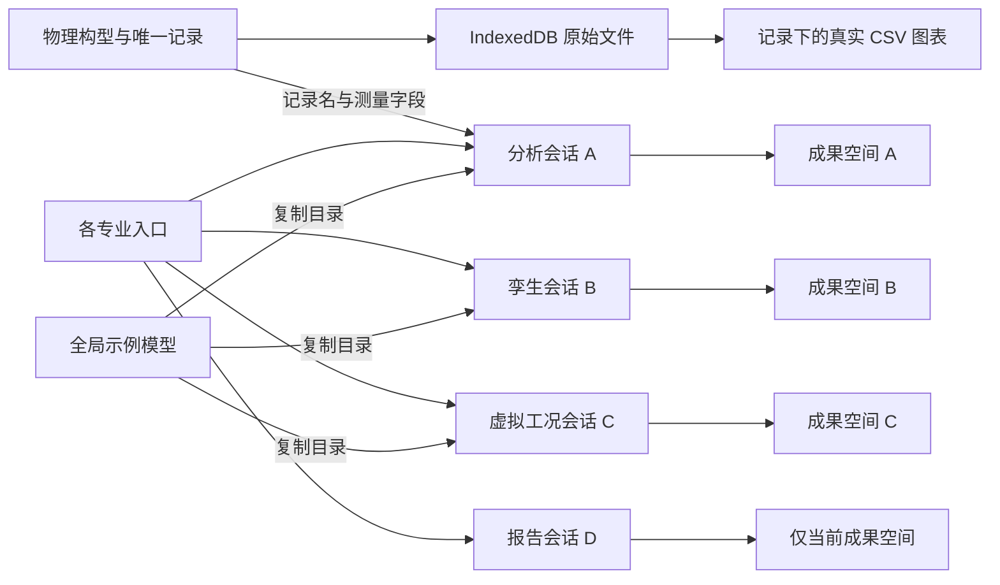
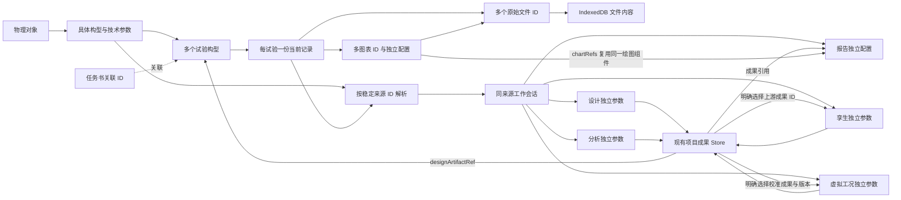

# ProTangram 跨功能数据共享与业务整合审查

本轮将专业功能连接到已有业务来源与成果引用机制：同一来源复用工作会话，原始记录、文件和图表仍各自只保存一份，各专业参数独立保存。未引入后端服务、新数据库或新的全局业务 Store。

业务依据是 `/mnt/d/物理对象.xmind` 的完整内容：3 个画布、1378 个节点、783 个备注节点。画布分别是抽象数据结构、对象类型、实例演示；旧的多记录、递归子对象示例以用户确认的七条规则覆盖。主 Agent 在三个只读审查完成后交叉核对结论，统一实施；数据和浏览器复核由未参与产品代码修改的 Agent 执行。

## 数据关系：修改前



原始数据归属本身已较清楚。主要断点是按“最后访问的能力”寻找会话，导致同一记录从不同入口建立多个成果空间；物理图表不在报告素材中；专业页面有各自的示例数据选择；文件名输入、模型定义、模拟结果与实测数据的边界没有贯穿保存和报告。

## 数据关系：修改后



来源身份由构型、试验、记录 ID 决定，名称、能力和任务书关联不参与身份匹配。既有字段 `physicalObjectId` 在专业上下文中仍表示具体构型 ID，以兼容原会话数据；对象家族通过构型归属解析。不会按同名对象、参数或文件猜测关联。

## 统一后的功能定位与实际数据流

| 功能 | 共享输入与来源 | 专属状态、输出与下游引用 |
|---|---|---|
| 原始记录与图表 | `physicalObjectStore` 中的构型、试验、记录；文件 ID 读取 IndexedDB | 文件管理、记录编辑、作图属于记录内操作。每张图独立保存字段、范围、缩放、偏移、样式和可选模型输入。 |
| 智能试验设计 | 共用来源、技术参数、原始文件名称及模型候选 | 目标、因子、采样与约束独立保存。手工 DOE 为配置方案；推荐方案保留演示性质。新试验可引用已保存方案并查看采点或因子，设置由用户填写。 |
| 数据分析 | 订阅读取同一记录，复用真实 CSV 图表 | 指标、范围和敏感度独立。当前异常、趋势和根因计算为演示；保存时带来源 ID 与演示标识，可被校准和报告选择。 |
| 数字孪生 | 同一记录的原始文件引用、按需选择的构型模型或示例模型 | 仿真基准和本次参数独立。当前校准为演示，保存成果并写当前来源会话的模型版本差量；不改原构型模型定义。 |
| 虚拟工况扩展 | 明确选择的校准成果、模型版本及同一业务来源 | 扩展范围、约束和模型输入独立。当前预测为演示，成果保存原始来源与上游校准引用。 |
| 报告 | 同来源专业成果的 `projectId + artifactId`，记录图表的 `chartRefs` | 模板、素材选择和标签绑定独立。真实图表直接读取原 CSV；含已知演示成果的报告保持演示性质，不自动登记正式任务证据。 |

保留五个专业工作界面，原因是它们的用户目标、专属参数和结果不同。统一的是来源选择、参数查看、原始文件和图表读取、模型候选、成果性质及引用入口。根因分析继续作为分析内部操作；图表不再需要另建数据集或专业工作空间。历史项目、任务工作台和旧分析入口保留兼容。

## 必要整改与对应证据

1. **统一同来源工作会话。** 原 `PhysicalObjectsPage` 查找同时要求能力匹配。现由 [sessionStore.ts](../../frontend/src/workspace/sessionStore.ts) 的 `ensurePhysicalSession` 按实体 ID 复用；能力仍通过 `drafts[capability]` 隔离。旧会话及成果不被合并或删除，同来源旧成果按引用发现。
2. **共用业务来源与返回入口。** [physicalBusinessContext.ts](../../frontend/src/workspace/physicalBusinessContext.ts) 负责严格解析和来源匹配；[PhysicalSourcePanel.tsx](../../frontend/src/workspace/PhysicalSourcePanel.tsx) 展示对象、构型、试验、记录、参数、原文件和图表。已有来源免重复确认；切另一来源进入对应会话。失效 ID 明确阻止操作，不回退第一项。历史记录按原 ID 只读展示。
3. **模型定义、输入与校准结果分开。** [useSessionModels.ts](../../frontend/src/workspace/useSessionModels.ts) 引用构型定义和已有目录；新会话只保存版本与校准差量，兼容旧目录快照。模型由用户选择，输入按能力与模型 ID 手填。选择已保存校准成果建立起始版本；再次校准可递增版本，旧成果不改写。跨来源 handoff 在写入前拒绝。
4. **复用真实图表。** [TrialChart.tsx](../../frontend/src/workspace/TrialChart.tsx) 被记录、共享来源和报告复用；[ReportCreate.tsx](../../frontend/src/pages/report/ReportCreate.tsx)、[ReportGenerate.tsx](../../frontend/src/pages/report/ReportGenerate.tsx) 保存并解析 `chartRefs` 和 `artifactRefs`。不复制 CSV、记录或图表配置。保存专业成果不再复制完整测量字段。
5. **保持成果性质与来源。** 现有专业保存入口统一带 `sourceScope`、`resultMode`、上游成果引用和本次模型输入。已知旧模拟写入器也识别为演示；手工 DOE 保持配置性质。来源性质不明的旧成果显示未标记，不猜测其计算真实性。成果总览、历史、图表摘要和报告都显示性质。
6. **减少入口与状态丢失。** 记录旁直接打开专业功能；侧栏专业入口保留当前来源；报告配置、编制、列表使用显式会话路径。独立旧路径不再根据最后活动会话猜业务来源。项目工作表行数不再被标成实际试验记录数。
7. **任务书只承担关联。** [TaskCenter.tsx](../../frontend/src/workspace/TaskCenter.tsx) 新建空关联实体，PDF 可选，不产生 AI 事项或自动执行。关联视图反查同一试验、记录、图表和专业成果；旧任务工作台保留。

## 独立验证与可复跑产物

- 54 项相关自动测试通过，包含 [crossFunctionSharing.test.mjs](../../frontend/tests/crossFunctionSharing.test.mjs) 的 8 项新增协同回归。
- 未参与产品修改的验证 Agent 独立执行 11 组数据断言，通过同来源复用、不同来源隔离、刷新、旧成果、图表引用、参数隔离、失效来源和数据保留检查。
- 最终代码的真实 Chromium 验证 14/14 通过，读取真实 ECharts 数据核对两张图的不同缩放与偏移；实际完成分析保存、演示校准、虚拟预测与保存、图表报告编制、设计引用、历史记录返回和任务书关联。旧字段报告列表兼容也实际通过：仅有 analysisProjectId 的旧报告可发现、打开并准确返回同一来源。
- 历史校准 `V1.0` 被明确选择后再次校准得到 `V1.1`，原成果仍为 `V1.0`。真实图表报告保存 `chartRefs` 与 `composed` 性质，刷新和返回列表保留同一会话。
- 浏览器初轮发现分析页循环渲染；主 Agent 修复稳定模型占位值与状态依赖，冻结后的实测无页面或 React 错误。
- 生产构建通过。相关文件 ESLint 无错误；历史自动执行 Effect 保留 5 项既有依赖警告，构建保留既有包体积警告。

浏览器脚本：[verify-cross-function-sharing.mjs](../../frontend/scripts/verify-cross-function-sharing.mjs)。结果保存在 `frontend/node_modules/.tmp/cross-function-sharing/results.json`。复跑时保持已有 Vite：

```bash
cd frontend
PROTANGRAM_TEST_URL=http://127.0.0.1:5174 node scripts/verify-cross-function-sharing.mjs
```

脚本使用独立浏览器 context，临时 Playwright、Chromium 及运行库位于 `/tmp/protangram-browser-check`；没有改系统开发环境或共享用户浏览器数据。

## 当前边界

共享的数据和成果仍保存在当前浏览器的 localStorage / IndexedDB，没有新增跨设备同步。专业推荐、异常识别、校准和虚拟预测仍使用现有演示逻辑，未验证真实工程精度；构型模型只有定义时不调用其他模型冒充执行。报告验证覆盖页面编制与本机成果保存，未验证 Word/PDF 导出、后台计算或外部接口。设计方案供试验引用，不自动转成实测数据。
